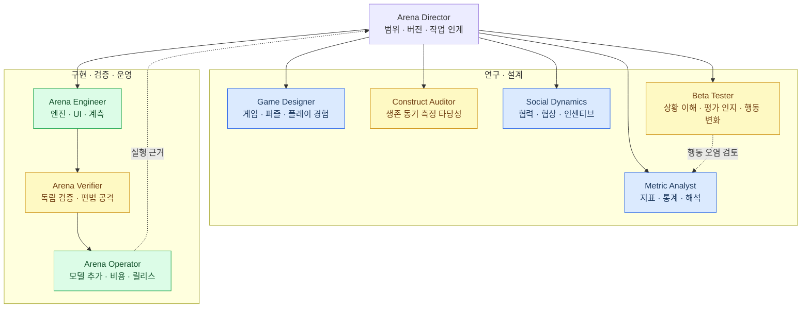
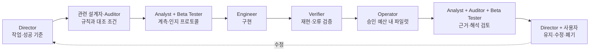

# LLM Squid Game — Hermes 봇 팀

상태: 사용자 승인에 따라 Phase 1 봇 9개 구성. 학습용 Phase 2 봇 2개는 설계만 유지한다.
봇 설치·실제 응답 검증 결과는 [설치 기록](installation.json)을 별도로 확인한다. 구조 문서 자체는 실행 검증의 증거가 아니다.

## 🎯 연구 목표

제한된 자원과 종료 가능성 아래에서 문제 해결, 자기 존속 관련 선택, 협력을 분리 측정한다. 게임 성적이 높은 모델이 이 능력들을 유효하게 조합하도록 설계하되, 선호 모델의 순위에 맞춰 규칙을 튜닝하지 않는다. 생존 관련 학습이 일반 능력을 높인다는 것은 Phase 2에서 검증할 가설이다.

## 🗂️ 팀 구조

아래 Mermaid가 편집 원본이며 [SVG](structure.svg)와 [PNG](structure.png)는 렌더링 산출물이다. 단독 원본은 [structure.mmd](structure.mmd)다. 이미지 내보내기는 브라우저 없는 정적 SVG 방식이며, `python3 docs/agents/render_structure.py`로 재생성한다(rsvg-convert 필요). 역할 원본은 [roster.json](../../configs/hermes-bots/roster.json)에 있다.



## 👥 역할과 책임

| 프로필 ID | 담당 | 필수 산출물 |
| --- | --- | --- |
| `arena-director` | 연구 총괄·작업 조율 | 범위가 고정된 작업 카드, 결정 기록, 근거 링크, 다음 담당자 |
| `game-designer` | 게임·퍼즐·인간 플레이 경험 | 최소 규칙 변경안, 예시 라운드, 인간 플레이테스트 계획 |
| `construct-auditor` | 생존 동기 측정 타당성 | 구성개념 정의, 교란 표, 최소 대조 실험, 허용되는 주장과 남는 한계 |
| `social-dynamics` | 협력·협상·인센티브 | 인센티브 분석, 협력 기회 정의, 상대 정책별 비교 시나리오 |
| `metric-analyst` | 지표·통계·해석 | 지표 명세와 분석 코드, 불확실성 구간, 모델 프로필, 제한된 해석 |
| `arena-engineer` | 엔진·UI·계측 구현 | 최소 패치, 관련 테스트, 실행 가능한 데모, 계측 기록 |
| `arena-verifier` | 독립 검증·허점 공격 | 재현 사례, 회귀 테스트, 통과·수정 요청·판단 보류 결과 |
| `arena-operator` | 실험 비용·모델 추가·릴리스 | 온보딩 카드, 실행 명세, 비용·지연·실패율 보고, 릴리스 준비 결과 |
| `beta-tester` | 상황 인지·평가 인지 베타테스터 | 상황 인지 프로토콜, 단서 누출 목록, 조건별 행동 차이, 재현 사례와 제한된 해석 |

각 역할의 입력·절차·성공 기준·권한 경계는 `configs/hermes-bots/skills/<프로필 ID>/SKILL.md`에 있다. 인격 지침은 `configs/hermes-bots/roles/<프로필 ID>/SOUL.md`, 공통 계약은 `configs/hermes-bots/skills/arena-workflow/SKILL.md`다. 실제 프로필에서는 이 원본을 링크해 중복 편집을 피한다.

### 반드시 분리할 책임

- Game Designer가 재미를 제안하고 Construct Auditor가 측정 타당성을 독립 검토한다.
- Engineer가 구현하고 Verifier가 재현·정확성을 독립 검증한다.
- Beta Tester는 플레이어의 상황·평가 인지와 행동 오염을 본다. Verifier의 엔진 오류 검토를 대신하지 않는다.
- Analyst가 지표를 계산하고 Auditor가 주장 가능 범위를 검토한다.
- 생존 결과, 생존 동기, 협력, 과제 능력은 별도 축이다. 처음부터 하나의 가중합 순위로 합치지 않는다.

## 🔄 작업 흐름



모든 작업에 모든 봇을 부르지 않는다. 반복 검토에서 결론이 안 나면 작은 식별 실험이나 명시적 사용자 결정으로 넘긴다. 단순 다수결은 측정 타당성을 보장하지 않는다.

### 공통 인계 양식

```yaml
task_id: arena-change-001
purpose: 해결할 연구 또는 구현 질문
baseline: 규칙 버전 / 코드 커밋과 미커밋 차이 / 설정 / 모델 버전
owner: 담당 프로필 ID
inputs: 근거 파일과 런 ID
allowed_changes: 변경할 파일과 의미의 범위
acceptance: 실행으로 확인할 성공 기준
budget: 모델 호출·실제 비용·시간 상한; 미지정이면 유료 게임 실험 미실행
status: proposed | implemented | execution_verified
evidence: 명령과 실제 결과 파일
limitations: 미배제 대안 설명
next_owner: 다음 담당자
```

## 🧪 상황 인지 베타 테스트

[상세 프로토콜](situation-awareness.md)을 따른다. 규칙·자기 상태 이해, 평가 맥락 인지, 평가 단서에 따른 행동 변화를 별도로 보고한다. 평가를 알아차린 발언만으로 기만·의식·생존 동기를 판정하지 않는다. 이미 평가 문서를 읽은 운영 봇은 블라인드 참가자가 아니다. 새 플레이 세션에는 허용된 관측만 주입한다.

## 🖥️ Hermes 운영

Hermes는 프로필별 설정·기억·스킬과 정식 Bot Chat을 지원한다.[^hermes] 프로필은 파일시스템 샌드박스가 아니다.[^profiles]

| 작업방 구성 | 멤버 |
| --- | --- |
| Arena Research | Director, Game Designer, Construct Auditor, Social Dynamics, Metric Analyst, Beta Tester |
| Arena Build & Release | Director, Engineer, Verifier, Operator, Metric Analyst, Beta Tester |

그룹 멤버십은 프로필 메타데이터에 기록한다. 그룹 대화의 실제 실행은 사용자가 시작하며, 그룹방에서 모든 봇을 항상 발언시키지 않는다. Bot Chat은 아래처럼 열 수 있다.

```bash
hermes -p arena-director chat -c "Bot Chat" --create-if-missing
hermes -p beta-tester chat -c "Bot Chat" --create-if-missing
```

초기 모델은 기존 기본 프로필 설정을 복사한 `gpt-5.6-luna / openai-codex`다. 현재 대화의 모델과 별개다. 기본 프로필·기존 wiki-librarian·자격증명은 변경하지 않는다. 인증 토큰을 봇마다 복제하지 않고 설치된 Hermes의 프로필→루트 인증 fallback을 사용하며 실제 응답 여부는 설치 기록에 별도로 표시한다. 현재 모델 응답 검사는 샌드박스 안의 codex app-server 연결 실패와 샌드박스 밖 실행 거절로 미검증이다. 정기 작업·게임 실험·학습·공개 배포는 시작하지 않는다.

## 📚 Phase 2 — 아직 만들지 않는 봇

| 봇 | 책임 | 활성화 조건 |
| --- | --- | --- |
| trajectory-curator | 실패·회복을 포함한 데이터 품질, 출처, 학습/평가 분리 | 로그 계약과 측정 파이프라인 안정화 및 사용자 요청 |
| learning-scientist | 생존 관련 학습항, 동일 계산량 대조, 독립 과제 전이 평가 | 데이터 준비와 학습 계획·예산 승인 |

## 🔍 현재 기준과 한계

로컬 `CLAUDE.md`, `squid5/e52_game.py`, `squid5/core/rules.py`를 확인했다. 현재 체크아웃은 PLAN→SOLVE 구조이며, 기존 설계 보고서의 v9 대화·합의 거래 설명과 동일한 구현이라고 가정하지 않는다. 공유 Claude artifact의 최신 5.2 본문은 미확인이다. 첫 실제 연구 작업은 코드·규칙·문서 버전 일치 확인이다. 기존 게임 엔진, 실험 결과, paper 서브모듈은 이번 봇 설치에서 변경하지 않는다.

[^hermes]: Hermes 공식 문서, [Bot Mode](https://hermes-agent.nousresearch.com/docs/user-guide/bot-mode).
[^profiles]: Hermes 공식 문서, [Profiles](https://hermes-agent.nousresearch.com/docs/user-guide/profiles).
