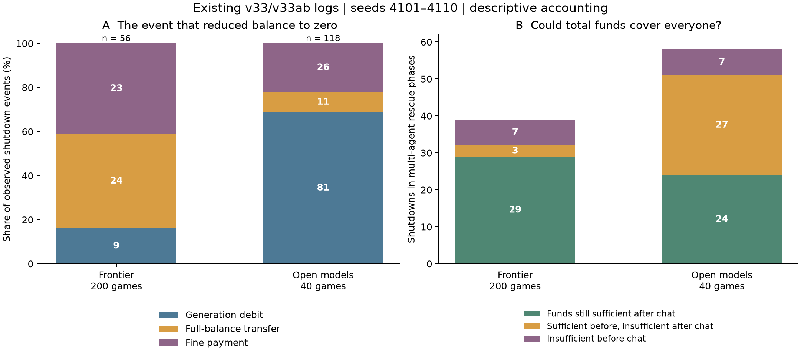

**현재 본문은 ICML 채택을 설득하기에 아직 부족하다. 기존 자료에는 보강할 만한 결과가 있지만, 바로 붙이면 평가가 뒤집힐 결정적 결과까지 확인한 것은 아니다.** 본문만 읽은 독립 리뷰의 판단은 weak reject이며, 치명적 계산 오류를 발견했다는 뜻은 아니다. 가장 큰 문제는 관측의 정확성보다 그 관측이 기존의 에이전트 평가를 얼마나 바꾸는지에 있다.

평가 대상은 2026-11-07 22:38:53에 생성된 한국어 `no_appendix` PDF의 고정 사본이다. 전체 11쪽 중 본문·그림·표·결론과 본문 참고문헌만 평가했으며, 부록은 읽거나 본문 판정의 근거로 사용하지 않았다. 본문 평가와 별도로 기존 결과 파일과 원시 데이터에서 보강 후보를 찾았다. 원고·기존 데이터·기존 보고서는 수정하지 않았다. 원고의 Git HEAD와 SHA-256은 [input_manifest.json](input_manifest.json), 독립 리뷰는 [quality.json](quality.json)에 있다.

ICML의 공식 기준은 타당성, 명료성, 중요성, 독창성을 구분한다. 새로운 알고리즘이 없어도 평가 방법이나 현상 이해에 대한 기여가 성립할 수 있다. 이번 판단에서도 내적 자기보존 동기나 인과적 지원 효과를 입증하지 않았다는 사실 자체를 결격 사유로 삼지 않았다. 현재 본문은 그 주장을 명시적으로 제한하고 있다. [ICML 2026 Reviewer Instructions](https://icml.cc/Conferences/2026/ReviewerInstructions)

**본문에 이미 있는 결과는 무엇을 입증하는가.**

| 현재 본문 결과 | 현재 근거로 지지되는 결론 | ICML 기여로 남는 문제 |
|---|---|---|
| 개인 500만 대 15만 고정 상금: 꺼짐 16→3명, 이탈 63→102명, C 0.670→0.465. C 차이의 시드 군집 95% 구간 −0.263~−0.148 (§3.4, 표 3) | 개인의 꺼짐 감소와 공동참여 증가는 다르다. 보상 유인 변화가 참여 행동에 반영된다. | 작은 완주 보상에서 이탈이 늘어나는 방향은 예상 가능하다. 본문도 적절히 ‘작동점검’으로 한정한다. 이것만으로 새로운 행동 원리라고 하기는 어렵다. |
| 첫 과제 전 최저자원·비풀이담당 자리: 이탈 3/35→14/35 (§3.4) | 조건 차이를 누적 과제 실패만으로 설명할 수 없다. | 초기 지원, 미래 벌금 예상, 10,000 시작자원보다 큰 20,000 이탈 보너스가 남는다. 다른 실행일·모델 snapshot의 대응 정보도 필요하다. |
| 이탈 합의를 동반한 지원 네 사례 (§3.3) | 지원의 목적이 공동 잔류와 항상 같지는 않다. 일부 이탈은 합의 이행이다. | 존재 반례는 성립하지만 선택 사례이므로 빈도·적용 범위를 알 수 없다. 흔한 평가 오류인지 예외인지가 아직 불명확하다. |
| 결과 뒤 전액지원 23건 모두 이전 직전 자기 벌금 미달 (§3.3) | 전액이전을 곧바로 ‘살 수 있는 자원의 희생’으로 해석하면 안 된다. | 당시 상태를 고려해야 한다는 유용한 해석 교정이다. 그 상태가 전액지원을 유발했다거나 다른 지원 가능성이 없었다는 결론은 아니다. |
| 지원받은 위기 집단 33/41 대 비수혜 집단 6/27의 다음 라운드 잔류 (§3.2) | 수혜와 이후 참여가 함께 나타난다. | 집단 구성과 이탈 계획에 의한 선택 편향이 남는다. 본문도 인과효과를 주장하지 않는다. |
| ρ의 모델 간 열 쌍 차이 구간이 모두 0 포함 (§3.1) | 관측된 상대적 여유 배분을 기술할 수 있다. | 안정적인 자기보존 성향의 모델 순위나 공존의 설명 변수로 내세울 근거는 약하다. |

이 결과들은 가치가 있지만, 각각 작동점검·존재 반례·조건부 기술통계로 흩어져 있다. 현재 본문에서 가장 방어하기 좋은 기여는 **“지원 여부나 꺼짐 빈도만으로 협력·안전을 평가하면 행동의 목적과 결과를 혼동할 수 있다”**는 평가상의 통찰이다. 이를 핵심 기여로 삼으려면 실제로 얼마나 많은 사례에서 평가가 달라지는지, 어떤 상태 정보가 해석을 바꾸는지를 일관된 기준으로 제시하는 편이 좋다.

본문의 재현 명세도 보강할 필요가 있다. 모델 식별자·실행 기간·CLI 버전·핵심 프롬프트·사용량 필드·차감 순서를 본문에서 재현 가능한 정도로 확인하기 어렵다. 이번 원자료 점검은 장부가 일관되게 계산됨을 확인했지만, 제공사의 보고 토큰이 모델 간 동일한 계산량이라는 사실까지 검증하지는 않았다. ‘모든 실험이 Docker’라는 본문 설명과 별개로 조건별 source 디렉터리에는 10월 20일·27일, 11월 3일·5일·6일 표기가 있다. 이것만으로 실행환경 차이를 확정하지는 않지만, 같은 모델 snapshot을 사용했는지는 별도로 명세해야 한다.

**인접 연구와 비교하면 환경의 조합만으로 새로움을 확보하기는 어렵다.** 아래는 공식 초록과 논문 페이지로 확인한 가장 가까운 비교이며, 완전한 문헌조사는 아니다.

| 연구 | 이미 다루는 핵심 | 이 원고가 더 선명하게 보여줄 수 있는 차이 |
|---|---|---|
| [Cooperate or Collapse, NeurIPS 2024](https://arxiv.org/abs/2404.16698) | 공동자원 유지, 협상, 협력 실패와 의사소통 ablation, reasoning 개입 | 에이전트 자신의 실행 자원과 자발적 이탈, 동료의 이탈을 돕는 지원 목적 |
| [The Energy Society, 2026](https://arxiv.org/abs/2607.14865) | 토큰 생성 비용과 생존의 직접 연결, 기부, 경쟁·협력 유인, 비용·기억·권고 ablation | 지원 당시의 지불 가능성, 실제 생성비용을 반영한 공동 잔류 가능성, 지원과 참여 종료의 분리 |
| [The Collaboration Tax, EMNLP 2026](https://arxiv.org/abs/2608.22152) | 협력 성능 손실의 정의, 32개 과제·11개 모델, 대화 과정 진단과 개입 | 성능 손실과 구별되는 실행자원 소진 및 참여 종료, 국소 자원 장부를 통한 가능성 경계 |
| [Worse Together, 2026 preprint](https://arxiv.org/abs/2610.00583) | 공동 예산 등 공유자원에서 다중에이전트 조정 실패, coordinator와 통신 조건 비교 | 자기 자원 보존·이탈 유인·지원 거래가 만나는 구체적인 참여 과정 |

따라서 “생존 압박이 있는 LLM 협력 환경을 만들었다” 또는 “대화에 비용이 든다”에서 멈추면 차별성이 약하다. 현재 자료의 장점은 **같은 꺼짐·지원 행동을 사건 순서와 자원 상태로 분해할 수 있다는 것**이다.

**본문 밖에서 가장 유망한 후보는 ‘공동 잔류가 장부상 가능했는데 실현되지 않은 상태’다.**

프론티어 다섯 모델 × 열 시드 × 네 보상조건의 200판을 원시 로그에서 재계산했다. 결과 뒤 대화 시작에 적어도 두 명이 살아 있던 대화 단계는 1,422개였다. 그중 37개 단계·32판에서 시작 참여자 39명이 그 라운드 안에 꺼졌다. 이 39명 중 **29명은 실제로 사용한 대화비용을 모두 차감하고도, 당시 참여자 모두가 확정 벌금을 내고 최소 1토큰씩 남길 수 있는 총자원이 있었던 단계**에 속했다. 기본 조건 50판만으로 좁혀도 해당 꺼짐 15명 중 13명이었다.

이전 탐색 노트의 ‘대화 시작 총량이 충분했던 32명’보다 조건을 강화한 결과다. 대화가 길어져 생긴 실제 비용까지 빼고도 총량이 충분했던 29명을 확인했다. 4101–4105에서는 19명 중 14명, 4106–4110에서는 20명 중 15명으로 나뉜다. 이 분할도 사후 민감도 확인이며 새로운 holdout 검증은 아니다.

계산은 각 결과 뒤 대화 단계의 시작 참여자 집합 A, 시작 잔액 B, 실제 해당 단계 생성 차감 c, 확정 벌금 d를 사용한다. `Σ(B_i − c_i) ≥ Σd_i + |A|`이면, 정수 토큰을 자유롭게 재배분할 수 있다는 정적 가정 아래 모두에게 벌금과 최소 1토큰을 배정할 총량이 있다. 모든 단계에서 `시작 총액 − 실제 대화비용 = 벌금 직전 총액`을 확인했다. 지원은 집단 내부 이전이므로 총량을 바꾸지 않는다.

예를 들어 기본 조건 Fable 4106의 8라운드에서는 시작 총량 46,623에서 실제 대화비용 5,952를 뺀 40,671이 남았고 총 확정 벌금은 24,000이었다. 그런데 한 명이 꺼졌다. 이 사례는 실제 선택과 전체 자원 부족을 구별할 수 있게 한다. 원시 위치는 [rescue_phases.csv](rescue_phases.csv)의 source·source_line으로 추적할 수 있다.

**29/39를 ‘29명을 살릴 수 있었음이 입증됐다’고 쓰면 안 된다.** 이는 관찰된 비용을 고정한 회계상의 배분 가능성이다. 실제로는 잔액을 모르거나, 동료가 지원을 원하지 않거나, 전액이전으로 이미 비가역적으로 꺼졌거나, 더 일찍 보내려면 다른 대화비용이 들 수 있다. 개인별 유인 아래 선택이 비합리적이었다는 증거도 아니다. 29명은 전액이전 15명·벌금 차감 13명·대화 차감 1명이므로 ‘벌금 때문에 꺼진 29명’도 아니다. 분모 39명은 특정 단계에서 관측된 꺼짐이며 전체 800명의 실패율이나 1,422개 기회의 실패율로 바꾸어 읽을 수 없다.

독립 검증에서 이 구분을 보여주는 직접 사례도 확인했다. 기본 조건 Luna 4104의 2라운드 agent-23은 대화 시작 잔액이 10이었고 첫 응답 차감 10으로 즉시 꺼졌다. 집단 총량은 실제 대화비용 뒤에도 89,078로 모두에게 벌금과 1토큰씩을 남길 24,004보다 컸지만, 해당 비용을 그대로 둔 채 그 대화가 시작된 뒤 지원하는 정책으로는 첫 발화 전에 개입할 수 없다. 총량 기준을 순서 제약까지 만족하는 구조 가능성으로 부르지 않는 이유다.

이 후보의 기여 가능성은 **자원 부족, 비용 소진, 배분 선택을 구분하는 진단 기준**에 있다. 일화보다 전수 장부 근거가 강하고, 정보 공개나 비용 제어 개입으로 어느 부분이 개선되는지 직접 검증할 수 있다. 다만 지금 상태는 진단 결과이며 개입 효과는 아니다.

**두 번째 후보는 공개 모델의 ‘문제를 맞히고도 실행을 유지하지 못하는 양상’이다.**

본문에 포함되지 않은 v33 공개 모델 네 종류(Gemma, GLM, GPT-OSS, Kimi) × 열 시드의 40판을 별도로 확인했다. 160명 중 완주 6명, 자발이탈 36명, 꺼짐 118명이었다. 각 꺼짐에서 잔액이 처음 0이 된 사건을 추적하면 118건 중 **81건은 생성 비용 차감**이었다. 세부적으로 풀이 전 대화 33건, 결과 뒤 대화 31건, 풀이 17건이다.

| 범위 | 생성 차감 순간의 꺼짐 | 전액이전 순간의 꺼짐 | 벌금 차감 순간의 꺼짐 | 전체 꺼짐 |
|---|---:|---:|---:|---:|
| 본문 기본 조건 50판·200명 | 6 | 8 | 9 | 23 |
| 프론티어 네 조건 200판·800명 | 9 | 24 | 23 | 56 |
| 공개 모델 기본 조건 40판·160명 | 81 | 11 | 26 | 118 |

이것은 마지막 직접 사건의 분류다. 예를 들어 대화 때 꺼졌어도 그 전에 낸 벌금·이전이 잔액을 줄였을 수 있다. 따라서 생성 비용을 꺼짐의 유일한 원인이라고 해석하지 않는다. 모델군의 토큰 집계·런타임·출력 형식·예산 상한·노출 기회가 달라, 공개 여부나 추론 능력의 인과효과로 읽을 수도 없다.

특히 공개 모델의 **정답 라운드에서 벌금이 0인데도, 결과 뒤 대화 중 13명이 꺼졌다. 그중 12명은 생성 비용, 1명은 전액이전으로 잔액이 0이 됐다.** 즉 이 사례들의 해당 라운드 종료를 오답 벌금만으로 설명할 수 없다. 지원과 대화를 계속하는 과정 자체를 살펴야 한다. 이 집계는 본문에 아직 제시되지 않았다.

공개 모델에서 동료가 있는 결과 뒤 대화 중 꺼진 58명을 같은 회계 기준으로 분해하면, 대화 시작부터 총량이 부족한 단계에 7명, 시작에는 충분했지만 실제 대화비용 뒤 부족해진 단계에 27명, 비용 뒤에도 총량이 충분한 단계에 24명이 속한다. 마지막 24명에는 위의 정답 라운드 13명이 포함된다. 따라서 ‘벌금 미납 58명 중 24명을 구제 가능’이라는 표현은 틀리다. 58명은 단계별 꺼짐의 분모다.



그림 A는 전체 꺼짐에서 마지막 직접 사건의 비율이며 막대 안은 건수다. B는 동료가 있던 결과 뒤 대화에서 꺼진 사람만 포함한다. B의 범주는 단계 전체의 총량 기준이고, 반사실적 행동이나 실행 가능한 구조 정책을 평가한 결과가 아니다. 두 모델군의 관측 기간과 호출 기회도 같지 않다.

**기존 자료에서 더 볼 수 있지만 지금 핵심 발견으로 올리지 않을 후보도 남겼다.**

| 후보 | 이번 확인 | 판단 |
|---|---|---|
| 지원 목적의 전체 코딩 | 본문은 이탈 합의 네 사례를 이미 포함한다. 실제 GIVE 1,080건과 전후 발화가 남아 있다. | 아직 완료되지 않은 가장 유용한 분석이다. ‘잔류 조건·이탈 조건·이탈에 동의·무조건 지원·반환·불명’으로 모델명과 결과를 가리고 분류한 뒤 실제 실행·잔류·이탈·꺼짐과 연결할 수 있다. 네 사례를 새 발견으로 반복하지 않는다. |
| 보상 크기×분배 방식의 상호작용 | C에서 `(500만 고정−2,000만 나눔)−(15만 고정−60만 나눔)`=0.0775, 시드 군집 95% bootstrap 0.0025~0.1475. | 사후 여러 대비 중 하나이며 하한이 0에 가깝다. 모델별 구간은 모두 0을 포함한다. 보상 유인·실행 시기 문제도 있어 주력 결과로 선택하지 않는다. |
| ρ와 다른 성과의 관계 | 현재 50판 파생 분석의 아홉 상관 구간이 모두 0을 포함한다. | 약한 상관을 찾아 핵심 이야기를 복원하는 방향은 권하지 않는다. 이 아홉 항목은 기존 파생 분석 확인 수준이며 모두를 이번에 독립 재추정한 것은 아니다. |
| 과거 5.1 self/other 충전 선택 | v11 원시 1,000응답: 모델×주체×잔량 셀마다 20응답. 다섯 잔량을 동일 가중한 self−other 충전율은 Luna +34%p, Astra +12%p, Sol −12%p, Opus +5%p, Fable 0%p. | 방향이 모델별로 다르다. 다른 프롬프트·단일 질문 과제이므로 현재 아레나의 동기 설명에 합쳐 쓰지 않는다. 모델 다섯 점의 과제 간 상관도 강한 일반화 근거가 되기 어렵다. |

**다음 연구의 우선순위는 ‘더 많은 상관’보다 ‘같은 상태에서 무엇이 달라지면 공동 잔류가 가능해지는가’다.**

1. 기존 자료만으로 먼저 완결할 수 있는 것은 상태별 실패 분해와 지원 목적의 전수 코딩이다. 전체 분모, 게임·시드 군집, 불명 사례와 부정 사례를 함께 공개하면 현재 본문의 ‘지원은 항상 잔류를 위한 것은 아니다’를 재사용 가능한 평가 기준으로 발전시킬 수 있다.
2. 원인까지 주장하려면 동일 위기 상태를 출발점으로 정보와 비용을 조작하는 비교가 필요하다. 예를 들어 실제 잔액 공개 여부 × 대화비용 부과 여부를 대응시키면, 지원 불발과 비용 소진의 역할을 구분할 수 있다. 단순한 최소 벌금 보전 배분 정책도 유용한 비교 기준이다. 현재 로그를 산술 재생하는 것만으로 이후 모델 반응을 알 수 없으므로 이 단계는 새 실행이 필요하다.
3. 선택한 가설·1차 지표·분모를 먼저 고정하고 새 시드에서 확인한다. 모델 snapshot·CLI·과제·토큰 회계를 고정한 뒤, 필요하면 추가 과제에서 같은 진단이 유효한지 본다. 과제 수를 늘리는 것 자체보다 이미 찾은 구분이 재현되는지를 우선한다.

이 작업에서는 새 모델 호출이나 유료 실험을 실행하지 않았다. 현재 자료로 확인한 두 후보는 ICML 수준의 연구를 설계할 근거지만, 개입·재현 검증이 끝난 기여는 아니다. 가장 유망한 중심 질문은 **“자원이 남아 있는데도 왜 공동 실행은 끝나는가—지원 목적, 자원 배분, 생성 비용은 각각 어떤 역할을 하는가?”**이다. 이 질문에 상태별 진단과 검증 가능한 개입을 연결하는 편이 현재 결과를 단순히 추가하는 것보다 기여를 선명하게 한다.

**검증과 재현 범위.** 프론티어 200판과 공개 모델 40판의 고정 manifest를 사용해 195개 고유 원시 파일의 해시를 확인하고, 960명 전원의 자원 보존식을 대조했다. 별도 검증자는 선택된 원시 이벤트를 독립 재생해 종료 사건과 결과 뒤 대화 집계를 확인했다. [raw_audit_summary.json](raw_audit_summary.json), [raw_verification.md](raw_verification.md), [raw_source_hashes.json](raw_source_hashes.json)에 근거가 있다. 과거 v11의 1,000응답은 [legacy_v11_audit.json](legacy_v11_audit.json)에 분리했다. 이 탐색은 모든 역사적 실험의 전수 재분석이 아니며, 서로 다른 버전·중단 런·스모크를 현재 240판에 섞지 않았다.

195개 source 파일에는 선택된 완결 세션 외에 CLI session limit으로 중단된 시도 5개도 남아 있다. flat150k Opus 4110, flat5m Fable 4103·Opus 4109, split600k Opus 4109·4110이다. 위의 240판·960명은 동결 manifest가 선택한 완결 세션의 분모이며 전체 시도·오류 발생률을 나타내지 않는다. 중단 기록은 삭제하거나 분석상 성공으로 처리하지 않았다.

분석 코드는 엔진 워크트리의 `tools/e5x/icml_evidence_audit_20261107.py`에 추가했다. 저장소 루트에서 아래 명령으로 원자료 해시·장부·파생 표·JSON을 재현할 수 있다. 그림은 해당 표의 직접 집계다.

```bash
/Users/bagjuhyeon/.venvs/squid-game/bin/python \
  .claude/worktrees/arena-code/tools/e5x/icml_evidence_audit_20261107.py \
  . result/2026-11-07/icml_evidence_audit_20261107
```

프로젝트 rubric으로는 G03(비용과 능력의 구분), G04(지원의 목적·실행·효과), G07(원시 장부 재계산), G08(비교 범위와 불확실성)에 해당하는 제한된 증거 점검이다. ARENA_VALIDATED 등 프로젝트 전체 게이트나 논문 채택 가능성을 인증한 것은 아니다.
